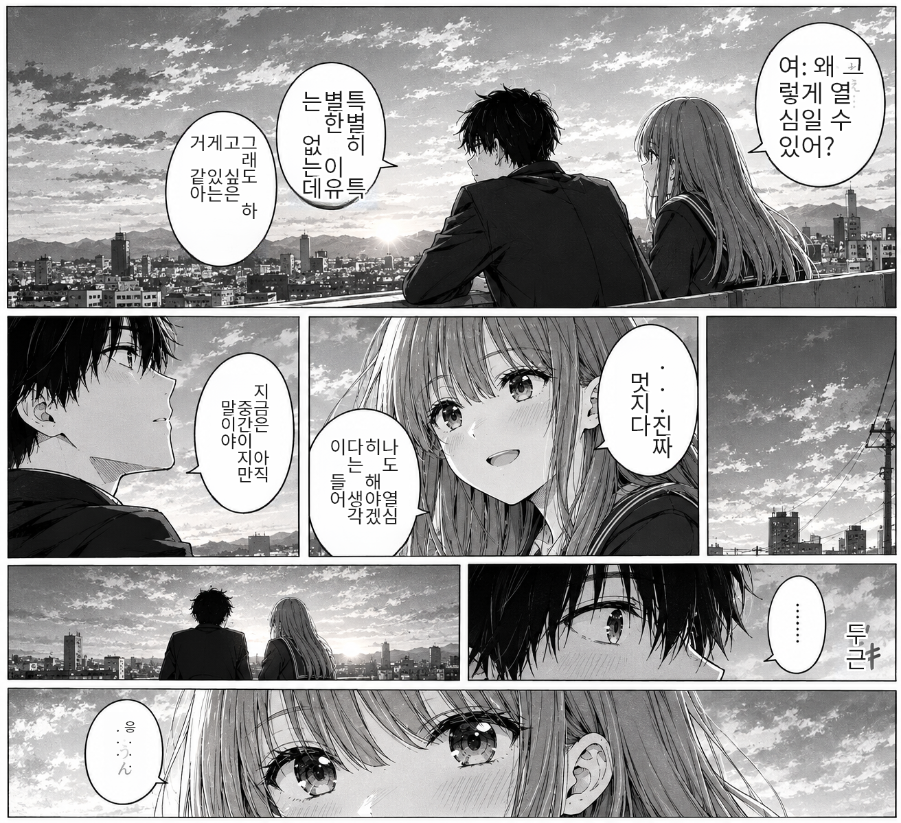

# Manga Translator — 日本語 → 한국어 만화 번역기 (local-first)

[](https://dotnet.microsoft.com/)
[](https://avaloniaui.net/)
[](#-os--하드웨어-지원)
[](#-os--하드웨어-지원)
[](#-모델-카탈로그--라이선스)
[](#-모델-카탈로그--라이선스)
[](#-모델-카탈로그--라이선스)
[](LICENSE)
[](#-모델-자동-다운로더-github-배포-대응)

만화 페이지의 일본어 말풍선을 **인식 → 배경 복구 → 번역 → 같은 위치에 재조판**하는 데스크톱 앱.
핵심 파이프라인은 전부 **온디바이스**(GPU 가속), 인터넷은 웹 번역 엔진·모델 최초 다운로드 때만 씁니다.

```
① 이미지 로드 → ② OCR 감지 → ③ 텍스트 제거(inpaint) → ④ 번역 → ⑤ 재조판
```

## 🖼️ 결과 샘플

| 원문 (日本語) | 번역 결과 (한국어) |
|:---:|:---:|
|  |  |

*Qwen3-VL OCR + Qwen3 번역 — 세로 말풍선은 원본 열 순서(오른쪽→왼쪽)·글자 크기 매칭으로 재조판합니다.*

- **OSS**: 앱 코드는 MIT. 동봉 이미지·모델 없음 — 첫 실행 시 공식 소스에서 자동 다운로드
- **GUI**: Avalonia 12 (밝고 트렌디한 라이트 테마 · 마법사 wizard UI) · 반응형 캔버스 오버레이 편집

---

## ✨ 기능

### 마법사 워크플로 (wizard)
우측 패널이 4단계 페이지로 전환됩니다 — **① 열기 → ② 감지 → ③ 편집 → ④ 실행·결과**
- 상단 스텝바: 진행 상태 색상 표시(현재=주황/완료=녹색), **방문했던 단계는 클릭으로 복귀**
- 하단 `◀ 이전 / 다음 ▶` 버튼, 단계 자동 전환(감지 완료 → 편집, 적용 완료 → 결과)

### 말풍선 편집
- OCR가 만든 사각형 인스턴스를 **캔버스에서 클릭-드래그로 선택·이동·리사이즈**(코너 4개 핸들)
- ☑ 체크된 말풍선만 제거·번역 대상 — 원문 직접 수정, 가로/세로쓰기 토글, **글자 크기 노브**(박스 내 strict-fit)
- **사각형별 🔄 재인식 버튼** — 목록에서 그 말풍선 하나만 OCR 재판독(Qwen3-VL→manga-ocr 폴백 경로)해 원문 복원
- **저신뢰(conf < 0.55) 항목은 빨간 경고 라벨** 자동 표시 → 편집 단계에서 즉시 확인
- 겹치는 검출 박스 자동 억제(고신뢰·대구간 승자 기준 contained≥50%·IoU≥0.30 드롭)
- 재조판 시 **자동 글자색 + 반대색 외곽선(halo)** — 회색 스크린톤 배경 위에서도 가독성 유지

### 번역 엔진 런타임 전환 (추상화)
로컬 GGUF와 웹 API가 `ITranslationEngine` **동일 인터페이스**라 파이프라인은 엔진을 구분하지 않습니다.
GUI 콤보박스 또는 `TRANSLATE_ENGINE` env로 즉시 교체:

| 키 | 엔진 | 필요 | 특징 |
|---|---|---|---|
| `qwen_gguf` | **Qwen3 GGUF (로컬)** | 모델 다운로드(32B 권장·14B 선택) | 무료·비공개·고품질. 둘 중 하나 보유 시 자동 선택(큰 쪽 우선) |
| `web_google` | Google 번역 | 없음 | 最速·무키. 차단 네트워크에선 MyMemory 자동 폴백 |
| `web_deepl` | DeepL | `DEEPL_API_KEY` | 월 50만자 무료 |
| `web_openai` | GPT/OpenAI 호환 | `OPENAI_API_KEY` | `OPENAI_MODEL`/`OPENAI_BASE` env로 모델·베이스 URL 지정 |

> 잡방(채팅) 모델 오염 방어: 번호 지정 배치 프롬프트(`1. 대사` → `1. 번역`) + 줄 수 검증 +
> 불일치 줄만 개별 미니멀 프롬프트 폴백 — `Core/Translate/NumberedBatchProtocol` 공통 구현.

### 모델 자동 다운로더 (GitHub 배포 대응)
저장소에 모델은 포함되지 않습니다. 앱이 부팅 때 카탈로그를 감사하고, 없는 모델이 있으면
**스플래시에서 목록+총 용량을 보여주고 다운로드**합니다.
- 번역 GGUF는 드롭다운 택1(기본 32B 권장 / 저사양 14B)
- **스킵 = OCR(Qwen3-VL)·LaMa·폰트는 받고 번역 GGUF만 제외** → 번역 엔진은 `web_google` 폴백으로 메인 진입
  (OCR 없이는 번역 자체가 불가하므로 "전부 건너뛰기"는 존재하지 않음)
- `.part` 이어받기(강제 종료 후 재실행 시 이어서), sha256+Content-Length 이중 검증, backoff 재시도
- 모델 교체·추가 = 카탈로그(`ModelManager`) 한 줄 — 코드 무접촉
- ✕(네모 X 배지) = 진행 중 앱 즉시 종료(이어받기 유지)

### 배치 모드 (Expander 편집 워크스페이스)
- 폴더/여러 파일 큐잉(png/jpg/jpeg/webp 재귀, 페이지 이름 순, 중복 제외) → 같은 설정으로 연속 처리
- 각 파일이 **Expander 카드** — 펼치면 그 페이지가 캔버스에 올라오고(懒 디코딩+자동 감지)
  **장(unit)별 말풍선 편집**(☑·박스·🔄재인식·크기·"이 장만 번역 실행")이 가능. 접으면 비트맵만 회수(편집 내용 유지)
- **연속 실행 규칙**: 펼쳤던(편집한) 장은 사용자 편집을 존중해 Apply, 안 펼친 장은 자동 Run.
  ☐ 전 해제 = "보존" 의도로 간주(원본 출력)
- 출력 `out/<name>_ko.png`, 진행률은 상단바·상태바 포함 **창 전체 오버레이** + 취소
- 상단 `📂 열기`에서 여러 장 선택 시 1장=싱글 편집·나머지=배치 대기열로 자동 분배

---

## 🚀 빠른 시작

```bash
git clone <repo> && cd manga
dotnet build MangaTranslator.slnx
dotnet run --project src/MangaTranslator.App          # GUI
```

첫 실행: 스플래시 → **📥 모델 다운로드 선택** (OCR rec Qwen3-VL-30B-A3B ≈18GB 필수 포함. 번역은 **32B 권장 ≈22GB** — 드롭다운에서 14B 선택 가능 ≈13GB)
→ 선택 번역 모델 포함 다운로드 → 경량 엔진 자동 로드(≈13초) → 이미지 열면 끝. 큰 GGUF(rec Qwen3-VL·번역 Qwen3)은 **첫 인식·번역 시점에 GPU에 오름**(순차 상재). ✕는 진행 중 **앱 종료**(이어받기 유지).

```bash
# CLI 검증 (GUI 없이)
dotnet run --project src/MangaTranslator.App -- --smoke
dotnet run --project src/MangaTranslator.App -- --pipeline <in.jpg> [out.png]
dotnet run --project src/MangaTranslator.App -- --audit            # 모델 감사
dotnet run --project src/MangaTranslator.App -- --getmodel font.noto_sans_kr
```

**요구**: .NET 8 SDK (런타임은 8/9/10 호환, `RollForward=LatestMajor`). 모델 캐시 경로는 `MANGA_MODELS_DIR` env로 변경 가능(기본 `models/`).

---

## 🖥 OS / 하드웨어 지원

| 플랫폼 | 상태 | 가속 |
|---|---|---|
| **macOS (Apple Silicon)** | ✅ 실측 완료 (M5 Max / macOS 26+) | **Metal** (llama.cpp ggml-metal, 전 층 오프로드) · ONNX CPU |
| **Windows x64** | ✅ 개발 1순위 | **CUDA 13** (RTX 5090 sm_120; CUDA 12.4는 Blackwell 미지원) / CPU 폴백 |
| **Linux x64** | 🧪 미검증 | **CUDA 13** (llama.cpp .Linux 바이너리 + ONNXRuntime.Gpu.Linux) / CPU 폴백 |
| Android | 🗓 계획 | 동일 Core 재활용 |

- **GPU 자동 정책(2026-10-25)**: macOS=Metal(llama.cpp) / Windows·Linux=CUDA 우선, GPU 없거나 초기화 실패 시 **CPU 자동 폴백**(llama.cpp ggml soft-fail + ONNX `OnnxSessionFactory.CreateWithCpuFallback`). CUDA EP 부재는 프로세스당 1회 감지 후 재시도 생략
- **⚡ CUDA DLL — 설치 없이 GPU(portable)**:
  - **CUDA Toolkit/cuDNN 설치 없이** RTX GPU 가속이 즉시 동작(Windows DLL 탐색 1순위 = exe 폴더). zip에 **모델은 포함되지 않음** — 첫 실행 때 스플래시 자동 다운로더가 수신(≈37GB).
  - **직접 빌드(git clone)**: 저장소는 코드만 담습니다(100MB/파일 제한). CUDA Toolkit+cuDNN이 설치된 PC에서는 실행 시 설치 경로 PATH 자동주입으로 GPU 사용, 미설치 PC는 CPU 폴백. GPU 배포판으로 재패키지하려면 `dotnet publish -c Release -r win-x64 --self-contained true` 후 설치본의 `cublas64_*·cublasLt64_*·cudart64_*·cudnn*_64_*` DLL을 exe 폴더에 복사(전체 세트 필수—부분 동봉 시 cuDNN 오류).
  - 오버라이드 env: `LLAMA_NGL`/`VLM_NGL`(GGUF GPU 층 수, 기본 99 전층)·`ORT_CPU=1`(ONNX 강제 CPU)·`ORTGpu=false`(빌드 시 CPU ONNX)
- 오버라이드 env: `LLAMA_NGL`/`VLM_NGL`(GGUF GPU 층 수, 기본 99 전층)·`ORT_CPU=1`(ONNX 강제 CPU)·`ORTGpu=false`(빌드 시 CPU 패키지 고정)
- Vulkan 미탑재
- **VRAM/RAM 권장**
  - 번역 32B q4_k_m(≈18.4GiB): RTX 4090/5090 32GB+ — 다운로드 선택 시 기본·권장
  - 번역 14B q4_k_m(≈8.4GiB): RTX 3060 12GB+·16GB Mac 저사양 선택지 (스플래시 드롭다운)
  - OCR rec Qwen3-VL-30B-A3B q4(≈17.3GiB)+mmproj(≈0.7GiB) 필수 — 번역 GGUF와 **순차 상재**(스테이지 종료 시 unload)로 32GB 카드에서 동작
  - PP-OCRv4 det+manga-ocr+LaMa ONNX 도합 ≈0.5GB(CPU/GPU 겸용), 웹 번역 엔진 선택 시 로컬 번역 모델 불필요

---

## 📦 모델 카탈로그 & 라이선스

앱 코드: **MIT**. 아래 모델은 저장소에 포함 **않으며** 최초 실행 시 표기 소스에서 내려받아 `models/`에 캐시합니다(카탈로그에 sha256 고정).

| 모델 | 용도 | 소스 | 라이선스 |
|---|---|---|---|
| PP-OCRv4 **det** | 말풍선 검출 | `SWHL/RapidOCR` | Apache-2.0 |
| **Qwen3-VL-30B-A3B** (GGUF+mmproj) | rec 판독(단일 rec·MoE 활성3B) | `Qwen/Qwen3-VL-30B-A3B-Instruct-GGUF` | Apache-2.0 |
| LaMa fp32 (ONNX) | 텍스트 제거 | `Carve/LaMa-ONNX` | Apache-2.0 |
| Qwen3 q4_k_m | 번역 — **둘 중 하나 선택**(다운로드 기본·권장 32B, 저사양 14B) | `ggml-org/Qwen3-32B-GGUF` · `unsloth/Qwen3-14B-GGUF` | Apache-2.0 |
| Noto Sans KR Regular/Bold | 한글 조판 | `googlefonts/noto-cjk` (HF gated라 GitHub raw) | OFL |

**주요 라이브러리**: Avalonia 12.1 / ReactiveUI 26 (MIT) · LLamaSharp 0.30 + ggml (MIT, Metal/CUDA) · Microsoft.ML.OnnxRuntime 1.31 (MIT) · SkiaSharp 2.88 (MIT) · SixLabors.ImageSharp **2.1.9** (Apache-2.0 — 3.x는 Split License라 고정)

웹 번역 엔진(Google/DeepL/OpenAI) 사용 시 각 서비스의 이용약관·API 키가 필요합니다.

---

## 🗂 구조

```
src/
├─ MangaTranslator.Core          # 의존성 0: ImageData·TextRegion·인터페이스·파이프라인·NumberedBatchProtocol
├─ MangaTranslator.ModelManager  # 카탈로그(HF repo/파일/sha256/host) — 모델 교체·다운로드의 단일 진실원
├─ MangaTranslator.Plugins.*     # Ocr.PpOcr · Ocr.MangaOcr · Ocr.VlmDots · Inpaint.Lama
│                                # Translate.QwenGguf · Translate.WebApi(google/deepl/openai) · Render.Skia
└─ MangaTranslator.App           # Avalonia GUI: 스플래시(엔진 프리로드+모델 다운로더) /
                                 #   PageEditor(단일 진실 편집 units: 캔버스·감지·적용) — 싱글=마법사,
                                 #   배치=파일별 Expander가 PageEditor 재사용 · 번역 엔진 런타임 콤보
```

엔진 교체: `EngineContext`에 팩토리 등록 + 카탈로그 키 — 파이프라인·UI 무접촉.

## 📝 개발 메모(요약)
- 번역/VLM은 **in-process LLamaSharp 0.30**(네이티브 DLL 직접 로드, macOS `.0.dylib` 심링크·CUDA는 csproj 타깃으로 OS 분기 자동 스테이징
- 입력 JPEG는 progressive(SOF 0xC2) → ImageSharp 2.1.9 디코딩 후 Skia 인도
- 참고 저장소(설계만, 코드 복사 금지): `zyddnys/manga-image-translator`(GPL)

## 라이선스
MIT (앱 코드). 모델 라이선스는 위 표를 따릅니다 — 배포 전 각 모델 페이지를 확인하세요.
